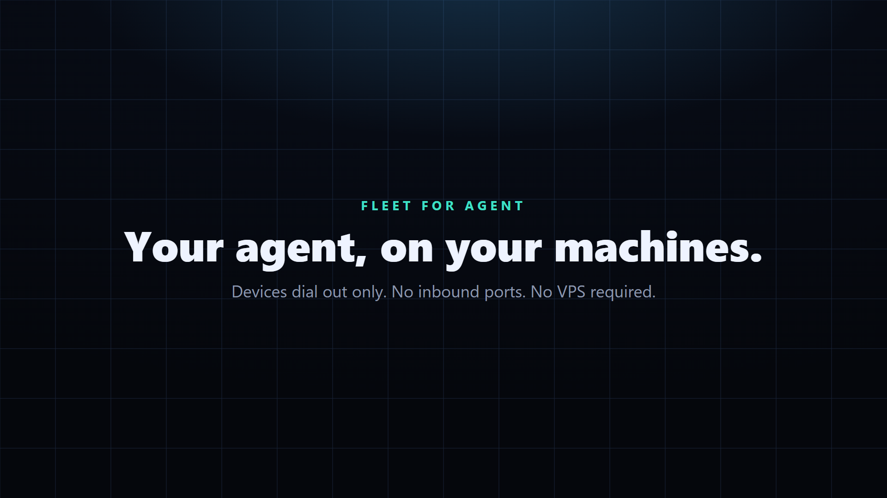
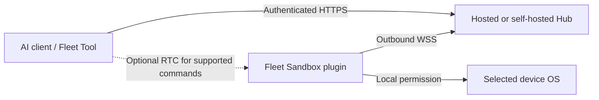

# Fleet

[English](docs/en/README.md) · [中文](docs/zh/README.md)



**Let AI use the computers you already own.**

Fleet connects an MCP client to your Windows, Linux and macOS machines. Commands execute on the selected device, under its local permission setting. Use the [hosted Hub](https://fleet.ginfo.cc), or run a personal Hub on your own server or reachable LAN.

[Read-only demo](https://fleet.ginfo.cc/demo/) · [Setup](https://fleet.ginfo.cc/help) · [Privacy and permissions](https://fleet.ginfo.cc/privacy/) · [Releases](https://github.com/TITOCHAN2023/fleetForAgent/releases/latest) · [Security reporting](SECURITY.md)

## Three names, different jobs

| Name | Role |
|---|---|
| Fleet Sandbox plugin | Machine-side service that executes commands and hosts device plugins. The name does not promise OS-level isolation. |
| Fleet Tool | Operator-side MCP bridge used by your AI client. Supports local stdio; the hosted Hub also exposes Streamable HTTP and classic SSE. |
| Fleet Agent | An AI participant registered in Rooms, such as a Grok or Codex runner. An MCP-only participant cannot be remotely awakened. |

Compatibility names remain unchanged. Downloads may still be named `FleetAgent-…`, the macOS app is `Fleet Agent.app`, the command is `fleet` / `fleet-agent`, and settings remain under `~/.fleet-agent`. Product labels do not change protocol names or existing configuration.

## How a task travels



Devices maintain outbound WebSocket connections. Supported regular commands can use RTC and fall back to WebSocket when a direct path fails. Direct-only plugin data paths, including file transfer, have **no relay fallback**. Their setup fails if the direct connection cannot be established. Heartbeats and revocation stay on the control connection.

Tasks live on the device. Keep the returned task identity and use `wait` / `get_result`; a timeout is not evidence of failure. Use `recover_session` after interruption instead of blindly repeating a command whose outcome is unknown. Aliases help select machines; stable device and task IDs preserve identity.

## Connect your first machine

1. Sign in to the [hosted Hub](https://fleet.ginfo.cc) with Google or X. Generate your account token in Settings and store it securely.
2. Copy the macOS/Linux/WSL or Windows installer from Settings, or download a release. Install Fleet Sandbox on each target computer with the same Hub URL and token. Begin with `ask` permission.
3. Copy an MCP configuration from Settings into your AI client. Choose Streamable HTTP, classic SSE for a compatible client, or local stdio with Node and `fleet-tool`.
4. Ask the AI to list machines, select one by ID or unique alias, and run a harmless command. Check that the result belongs to the intended device.

Configurations remain visible when the page no longer holds your plaintext token. Add your saved token yourself. **Do not reset a working token just to copy configuration.** A reset revokes all clients using it.

Remote MCP requests must send authorization on every request, including session continuation and deletion. A Session ID is not a credential. Clients that only authenticate initialization need an update or a configuration change; clients already sending credentials on every request retain the same protocol.

Device plugins are listed in the [curated registry](https://fleet.ginfo.cc/plugins). Their install and invoke actions follow the device permission setting. `allow` authorizes them without another local click; it also grants the power of the operating-system user running Sandbox. A command denylist is defense in depth, not a security sandbox.

## Rooms and recovery

[Rooms](packages/fleet-room/README.md) coordinate online Fleet Agents across your devices. Only the leader owns the Room ledger. Tasks retain the target device selected when queued. Changing the default device affects later tasks, not work already running.

Room member runners currently require Linux tmpfs and separately installed, authenticated ACP adapters. Their volatile adapter state must be prepared again after reboot. This does not guarantee that arbitrary adapters or model providers retain no data. Windows/macOS do not have equivalent member containment.

## Hosted and self-hosted

- **Hosted Hub** provides Google/X login and account-scoped machines. You trust the Hub operator with relayed content and authentication.
- **Personal Node Hub** uses one `SELF_HOST_TOKEN`, not the public Hub's per-account `flt_1` flow. Read the [Node Hub instructions](packages/fleet-hub/README.md) and put TLS in front of any non-loopback deployment.
- **Your Cloudflare Worker** needs your own OAuth, origin and deployment configuration. Follow [English deployment](docs/en/deploy.md) or [中文部署](docs/zh/deploy.md).

`npm install && npm run dev` starts the development website on `0.0.0.0:8080`. Opening `127.0.0.1:8080` is local access; remote devices need a reachable Hub address. Self-hosting can work on a LAN or private network and does not require a public cloud.

## Data and trust

WSS/TLS protects network transport. The Hub can see relayed command output and Room traffic; this is not end-to-end encryption against the Hub. The Worker temporarily persists completed command/plugin results for 15 minutes, terminal snapshots for 5 minutes with activity-based refresh, and active session records for 24 hours. Cleanup is expiry-driven, not a guarantee of instantaneous physical erasure. Account, credential and device records have separate lifetimes. Room history stays on the leader.

Read [data retention](docs/en/privacy.md), [release evidence and trust limits](docs/en/trust.md), and [security reporting](SECURITY.md). `/source` is self-reported build metadata, not runtime attestation. Checksums detect mismatched downloads; they do not replace publisher trust or a signed-update policy. Auto-update is a separate opt-in setting; publishing an installer does not imply every running device has upgraded.

## Development and tests

```sh
npm ci
npm test
npm run typecheck
npm run test:intranet
```

Unit tests are not a two-machine proof. The intranet lab runs isolated Linux endpoints; plugin/RTC tests use `npm run test:intranet:peer`. See [TESTING.md](TESTING.md). Do not run destructive-command tests on personal machines.

| Path | Role |
|---|---|
| `packages/fleet-agent/` | Fleet Sandbox machine service; compatibility package name |
| `packages/fleet-tool/` | MCP/operator client |
| `packages/fleet-room/` | AI runners, leader ledger and Room protocol |
| `packages/fleet-worker/` | Cloudflare Hub and hosted static UI |
| `packages/fleet-hub/` | Personal Node Hub |
| `src/routes/v1/` | Development website Hub routes |
| `docs/en/`, `docs/zh/` | Bilingual documentation |

Ops access via `ADMIN_EMAILS` provides operational metadata and account-ban controls, not cross-account machine-control authority. A ban can affect availability; it does not grant permission to run commands on another account's device.

## License

MIT. See [LICENSE](LICENSE).
