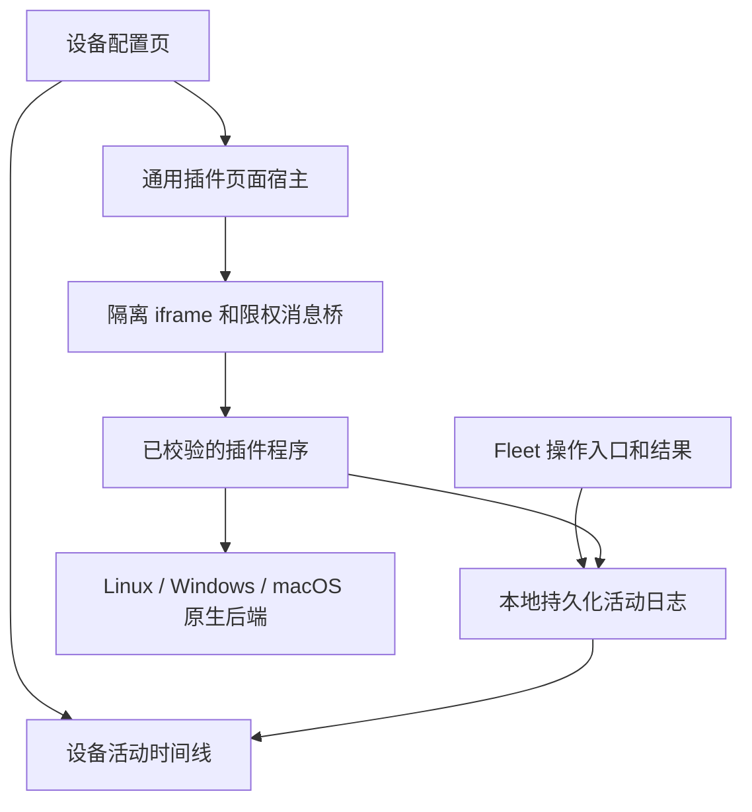
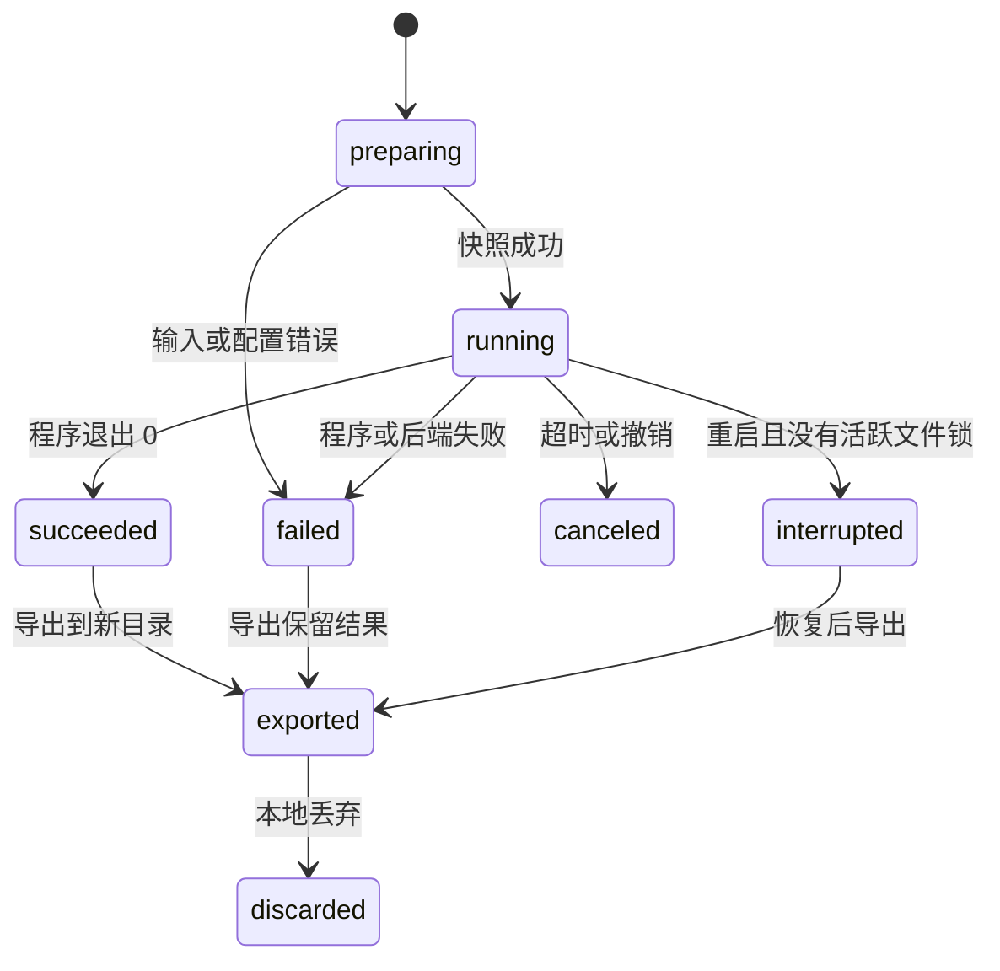
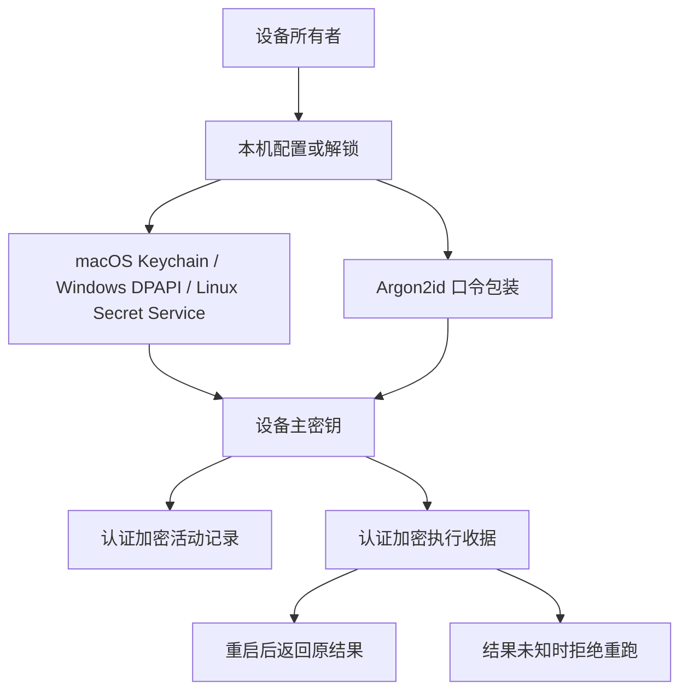
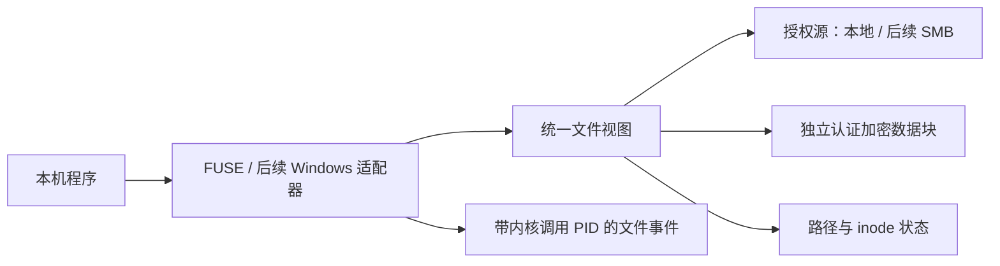
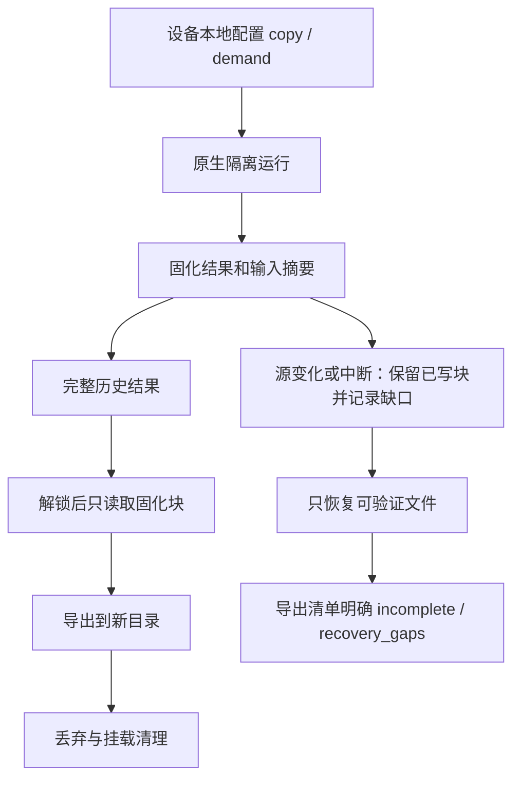
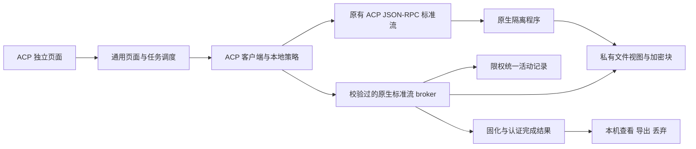
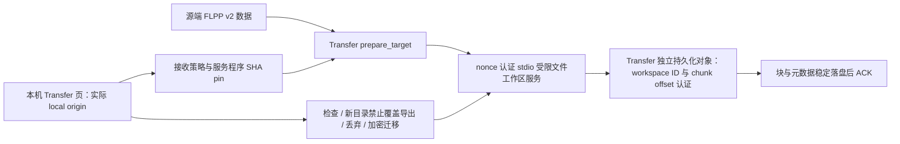

# Fleet 设备插件页面、活动记录与原生沙箱

本方案以整台被控设备为管理单位，覆盖 Fleet 发起的命令、插件、桌面操作及相关进程行为。设备本地是数据源；Hub 继续负责认证和通用传输。



## 完整 Goal 与验收清单

以下是整个方案的范围。实现状态必须以测试和运行证据更新，不能把编译通过当作运行验收。

- [ ] 通用插件页面：声明、制品校验、隔离加载、限权调用、主题/语言、升级/卸载生命周期。
- [ ] 设备活动：请求、授权、执行、结果；命令、插件、桌面操作、进程、文件、网络关联。
- [ ] 持久化、分页、过滤、实时增量、重启恢复、导出、保留窗口和采集缺口提示。
- [ ] 可信调用上下文、幂等、取消、deadline、停用与身份撤销。
- [ ] Linux、Windows、macOS 本机程序的隔离与实际运行验证。
- [ ] 工作区差异、冲突检测、结果导出、丢弃和恢复。
- [ ] 原有命令、ACP、Transfer 通过通用接口接入；旧调用保持兼容。
- [ ] 透明文件合并视图、加密持久化、实时 Trace、SMB 与按需文件访问。
- [ ] 三端安全/兼容性测试、构建和安装说明。

## 当前接口

这些接口只监听本机回环地址，保持现有 Host、Origin、HTTP method 和 JSON 校验。

- `GET /api/plugins`：设备已安装插件及可选 UI 声明。
- `POST /api/plugins/open`：校验程序与声明，调用 `ui.page_action` 获取自包含 HTML，发放短期页面能力。
- `POST /api/plugins/invoke`：仅允许页面声明的 actions；写入继续经过设备 permit。
- `GET /api/plugins/result`：查询该页面自己的任务。
- `POST /api/plugins/close`：撤销页面能力，并取消该页面尚未完成的调用。
- `POST /api/plugins/uninstall-local`：卸载入口并归档保留插件数据。原有远端 uninstall 语义不变。
- `POST /api/plugins/cancel`：取消该页面自己的任务，包括等待批准的任务。
- `POST /api/plugins/install-local`：本机用户显式安装校验过的开发包。远端安装仍受官方注册表限制。
- `GET /api/activity`：按 kind、plugin_id、corr、after、before、since、until、limit 查询；时间为 Unix 毫秒。
- `GET /api/activity/export`：导出保留窗口内 JSONL。
- `POST /api/plugin-activity`：限单次调用、限插件、限 corr 的 bearer 通道；凭据不传入任务程序。

插件 UI 声明示例：

```json
{
  "ui": {
    "title": "Example",
    "page_action": "ui",
    "read_actions": ["inspect"],
    "write_actions": ["configure", "run"]
  }
}
```

UI actions 必须是已声明的 task actions。`page_action` 返回 `{ "html": "..." }`，由 Core 放入无同源权限的 iframe。页面通过 MessageChannel 发送 `{type:"fleet.call",id,action,input}`，接收 `{type:"fleet.result",id,result,error}`。它没有任意 Core API、外部网络或其他插件权限。升级改变程序或页面声明后，旧页面能力失效。

## 活动语义

Core 生成的请求与结果标记 `source=core`；插件上报标记 `source=plugin`。事件不得把模型输出当作 OS 证据。截图和输入文字默认只记录操作与长度，避免在审计库重复保留内容。命令中的常见凭据字段、完整引号值、Bearer/Basic 头、Cookie 和 URL 用户信息被脱敏；对应凭据残留测试通过。

活动日志独立于原有 200 行运行日志，使用顺序 JSONL、两个 32 MiB segment、稳定序号和同步写入。日志只在取得设置监听端口后打开，并由跨进程文件锁保证单写者；重复启动不会再追加冲突序号。重启恢复未完成尾部；完整记录损坏会拒绝打开，不能静默忽略。超出保留窗口会提示 gap。日志写入失败在设备页报告，不能声称审计完整。

活动日志现在支持认证加密。单条内容和序号被绑定验证；缺失的中间序号会拒绝读取。尚不具备外部可信锚点，不能声称能够检测整份旧备份的回滚。默认兼容原有明文模式，设备所有者可启用加密。

## 原生沙箱的当前边界

- Linux：Landlock 与 seccomp；可用时始终使用 user/PID/network namespaces。PID namespace 的 init 退出后内核清理全部派生进程；ABI 6 没有可用 namespace 时隔离仍可用，但明确报告完整进程树约束为 false；ABI 3–5 缺少 namespace 时拒绝执行。文件写入限制在私有工作副本；禁止网络和越界信号/调试等旁路。可用的 strace 提供受保护的实时系统调用记录；缺失时覆盖标记为 false。Trace 文件限制 32 MiB，超过限制会终止执行并报告缺口；参数字符串限制 256 字节。
- Windows：AppContainer（无网络 capabilities）与 Job Object；仅修改私有工作区 ACL。工具必须能在 AppContainer 权限下执行，不能为了兼容而扩大宿主目录权限。
- macOS：实验性 Seatbelt 启动器，无限制执行不会作为 fallback。可分发的签名 App Sandbox helper、完整进程/文件/网络采集仍待验收。

旧配置默认使用独立副本；Linux 已接入 `demand` 按需合并视图、加密块、任务结束固化与离线恢复。两种模式都拒绝输入符号链接、硬链接和特殊文件，限制 512 MiB、10000 个条目，并隐藏 `.git`。macOS、Windows 的按需挂载尚未验收。任务环境重新构造，不继承 Fleet 或模型服务凭据。文件 diff 表示最终变化，不表示逐次文件访问。

开发安装后，可通过 `fleet settings` 查看本地 URL。Linux 不自动打开浏览器；无桌面机器使用 CLI。


## 工作区生命周期

`list` 返回持久化工作区；`inspect` / `diff` 返回执行结果与最终变化。每个工作区使用独立的 OS 文件锁，运行、查看、导出和丢弃不能并发修改同一个工作区。重启后，只有取得锁的陈旧 preparing / running 标记才会被恢复为 interrupted。

`export` 仅由设备本地页面发起，目标必须是不存在的新目录。导出目录包含 `files/` 和 `manifest.json`，后者保留删除记录、原输入目录在快照后发生的变化、输入不可读状态。发布目录使用各系统的禁止覆盖 rename。它不把删除或修改自动应用到原输入目录。结果中的链接和特殊文件不能导出。



## 2026-10-14 验收证据与剩余工作

| 模块 | 已实现及验证 | 未完成的验收 |
| --- | --- | --- |
| 页面宿主 | 可选 UI 声明、程序和声明校验、iframe、限权 RPC、主题/语言消息、关闭取消、升级失效、卸载归档；实际浏览器打开沙箱页并查询工作区 | ACP/Transfer 页面已接入本机 Agent；三端完整交互、ACP 原生标准流已接通，Linux/macOS 合成协议与 Linux 设备 API 验证通过；Windows、真实模型工具兼容和 Transfer 沙箱接入仍待验收 |
| 活动日志 | 顺序持久化、历史和增量分页、插件/任务/类型/时间过滤、重启修复、导出、脱敏、保留窗口；上报不能伪造设备、调用者、插件或任务；写入失败不确认成功 | 外部可信锚点与防回滚；全部普通命令/ACP/Transfer/桌面派生进程的 OS 采集 |
| 调用生命周期 | 插件调用收据持久化；重启返回已保存结果，未完成收据拒绝自动重跑；同一调用只执行一次、不同输入/调用者拒绝重放、页面取消、停用/撤销、任务 deadline；针对相关代码的 race 测试通过 | 普通命令、终端输入、桌面输入已接入相同收据；截图/读屏保留实时读取语义；更多三端实际运行恢复仍待验收 |
| 工作区 | 独立副本；Linux 按需合并视图、立即加密块、固化、离线恢复、缺口提示；持久化状态、锁、差异、冲突报告、禁止覆盖导出、本地丢弃 | 两端按需挂载、副本模式运行中磁盘明文处理、SMB |
| Linux 原生 | 独立 Debian 13 / kernel 6.12.95 实测；strace 6.13，5 个相关 PID、188 条系统调用，Trace 在任务结束前到达；外部文件读取与网络创建拒绝；取消和导出通过；真实 Fleet Agent 链路验证了重复启动不改变序号、34 条带可信身份的插件上报及六类活动关联 | amd64 实机；ABI 3–5 namespace 路径实测；更多工具兼容 |
| macOS 原生 | 本机 arm64 实测 shell 与直接 syscall 探针；授权读写、外部文件及网络拒绝、取消和导出通过 | 正式签名后端；完整派生进程生命周期、逐次文件与网络 Trace；amd64 实机 |
| Windows 原生 | AppContainer + Job Object 实现；已改为创建进程时 JOB_LIST 原子归属并保留三项启动属性，最低 Win10/Server2016；amd64/arm64 编译、vet与测试编译通过 | Windows 实际运行、安全与兼容性验证，OS Trace |
| 构建与回归 | 六平台开发制品；activity/sandbox race、页面和 Peer 相关 race、go vet；除下列 RTC 用例外的完整 race 回归通过 | 完整回归仍有 RTC 建连超时；相同超时在原始 HEAD 的干净副本复现；未发布、未部署 |

macOS 的 `process_tree_containment=false`：当前进程组清理不能作为全部脱离进程组子进程的保证。不能用轮询进程列表或旧版 kqueue NOTE_TRACK 冒充完整采集；Apple 当前 XNU 明确拒绝 NOTE_TRACK / NOTE_CHILD（[Apple XNU 源码](https://github.com/apple-oss-distributions/xnu/blob/main/bsd/kern/kern_event.c)）。正式后端需要完成受支持的进程归属与采集方案及其授权验收。

下一阶段按完整 Goal 继续：补 ACP、Transfer 的沙箱执行/文件能力，完成透明文件视图、三端采集、SMB/按需访问和三端实际验收。Windows 测试环境仍等待用户提供。

插件程序在 [fleet-sandbox-plugin](https://github.com/TITOCHAN2023/fleet-sandbox-plugin)。`sh scripts/build.sh` 生成六个平台的制品和 `dist/manifest.json`，再用 `fleet plugins install-local` 安装那个目录。发布制品的 URL 和 SHA-256 记在官方插件注册表里。


## 活动和执行收据加密

设备页增加数据保护配置与解锁入口，CLI 对应：

- `fleet storage`：显示配置、锁定与模块加密状态。
- `fleet storage setup`：使用系统密钥存储初始化。
- `fleet storage setup --password-stdin`：从非交互 stdin 接收口令初始化。
- `fleet storage unlock --password-stdin`：在设备本机解锁口令模式。

配置/解锁前应停用设备并结束插件任务；已有数据转换成功后才切换。活动与收据拥有独立状态，不把尚未加密的插件工作区标为已加密。口令模式重启后需要本机重新解锁；锁定时拒绝命令、插件写操作和桌面操作。系统密钥丢失、口令错误或数据认证失败都不会自动生成新密钥。



认证加密使用 AES-256-GCM，每次生成随机 nonce；按对象用途派生密钥并绑定对象/序号。口令包装采用 [RFC 9106 的 Argon2id 内存受限配置](https://www.rfc-editor.org/info/rfc9106/)：64 MiB、3 次迭代、4 lanes、16 字节 salt。Linux 系统密钥适配使用 [Secret Service API](https://specifications.freedesktop.org/secret-service/latest-single/)；服务不存在或已锁定时可选择口令模式。

本轮实际 Agent 口令验收通过：旧日志和收据转换、明文日志移除、锁定重启、口令解锁保留历史、新页面查询旧调用结果。篡改、错误密钥、结果未知时拒绝重跑等测试通过。自重启、自升级、内网自动更新曾被单写者锁阻挡，已增加显式释放与失败恢复交接，原有用例重新通过；除原始 RTC 超时用例外的完整 race 回归通过。系统钥匙串适配器通过三端编译，实际系统服务验收仍未完成。

## 2026-10-15 实现与运行证据

插件调用通过限时、限插件的 `/api/plugin-storage-key` 取得各自的派生密钥；设备主密钥不会返回给插件，任务程序环境不包含取钥匙或活动上报凭据。沙箱配置、工作区元数据和结果使用认证加密；工作文件与原始 Trace 使用分块 AES-GCM，并绑定工作区用途、块序号和长度。读取要求认证终止块，拒绝截断、交换、追加与用途错配；确认密文可完整验证后才移除对应明文。

`encrypt_storage` 由本地页面发起，迁移旧工作区；活跃锁定工作区计入 busy。导出临时解密视图，完成后删除临时副本，显式导出的结果保持可读。Linux 原生 Agent 实测通过工作区及原始 Trace 封存、旧数据迁移、重启解锁和导出恢复；macOS 原生 Agent 实测通过工作区迁移、封存及重启后导出。macOS Keychain 实际写入/读取/删除合成测试条目通过。

加密范围必须准确：程序执行时工作视图仍是明文，异常退出可能留下尚未封存的视图；所有者可在解锁后执行迁移。无法安全归档的输出会保留数据并报告加密覆盖缺口。当前后端不能声称提供运行期间的透明加密文件系统；macOS 的派生进程约束缺口也仍存在。

普通命令、终端输入和桌面输入复用持久化收据。输入仅写入摘要；同一 corr 不同类型、输入或调用者被拒绝。命令即使失去响应传输仍保存完成结果，重启重试返回原结果；未知结果不自动重跑，未知意图不会因保留时间过期而变成可执行。已完成结果保留一小时；总数限制为 512，达到上限明确拒绝新调用。桌面 consent 表示尚无输入副作用，收据允许相同请求在本地批准后重试。真实命令写入测试和桌面模拟后端 race 测试通过；存储切换拒绝活跃命令/输入。普通命令还记录真实启动 PID、完成与退出码；批准后的执行保留原请求调用者。coverage 明确指出这些普通命令尚无完整子进程、文件和网络采集，不能把根进程记录冒充全部派生行为。

ACP、Transfer 的独立仓库增加可选页面声明。ACP 页面提供配置、配置列表与委托；Transfer 页面显示实际传输限制，文件传输仍由控制端发起并保留双端逐次批准。Transfer JSON 页面调用与 FLPP Peer 流复用同一入口，原传输数据协议不变。ACP 子进程不继承新增的取钥匙或活动上报能力。两插件原有完整 race 回归通过、六端二进制构建通过；真实本机 Agent 验证了三插件页面打开、ACP 配置与合成任务委托、Transfer 限制查询及可信活动关联。

ACP 旧 profile 保持原有执行方式，新的本地策略可显式启用原生隔离；其标准流、私有目录、持久化与设备活动已接通，见后文。ACP 配置文件本身仍未纳入沙箱工作区加密；Transfer 已补显式私有接收工作区，最新实现和验收边界见后文。透明文件视图、SMB/按需访问、全部 Fleet 派生进程/文件/网络采集和 Windows 实际运行继续属于完整 Goal。未提交、未推送、未发布、未部署到正式设备。


## 按需文件层：基础实现与原型验收

新增 `internal/sandbox/overlay`：源接口只负责目录元数据和校验版本的读取，文件视图负责独立写入、重命名、删除、打开句柄、限额与恢复。创建视图不读取文件内容；数据按 64 KiB 块访问，修改后的块在启用加密时立即以认证密文持久化。元数据提交后才回收旧块；重启清理未提交块和没有打开句柄的已删除文件。逻辑文件总量和已分配块各限制 512 MiB，条目限制 10000，句柄限制 1024，单次 IO 限制 1 MiB。

本地源复用禁止符号链接、硬链接和越界路径的读取；读取前后检查文件身份、大小、模式、mtime 和 ctime/Windows ChangeTime。目录清单隐藏 `.git`。源发生变化时不把新内容混入旧视图，而是返回明确错误；当前模块是带版本校验的按需视图，尚不能声称它保留了未读取文件的完整历史快照。



Linux FUSE 真实挂载验收通过：同一原生沙箱 helper 的 Landlock/seccomp 下执行 shell，完成读取、写入、追加、目录创建、chmod、重命名、删除；原输入未改变，挂载前内容读取字节数为零，存储对象未出现测试明文，文件操作事件包含内核提供的 PID。只在独立 Debian 测试机安装官方 fuse3 助手；没有安装 Mac 驱动或变更正式设备。

共享文件层的 race 测试覆盖加密写入、无写回、按需获取、并发写入/追加、删除后打开句柄、中断后的块回收、截断再扩展不暴露旧内容、额度、路径与源变化拒绝。本机 macOS 本地源测试通过；Windows 本地源与共享层完成双架构编译，实际运行仍待验收。

这一阶段最初仅完成独立模块；其后 Linux 已接入设备页 `run/list/diff/export/discard`，验证状态见下方 2026-10-15 生命周期章节。SMB 源、macOS/Windows 挂载适配与实测继续执行。

不直接使用可变项目目录作为 Linux 内核 OverlayFS 下层：内核文档指出挂载期间修改底层文件系统的行为未定义（[Linux OverlayFS 文档](https://www.kernel.org/doc/html/latest/filesystems/overlayfs.html#changes-to-underlying-filesystems)）。FUSE 适配采用已固定校验和的 go-fuse v2.8.0，其 Go 版本要求没有提高 Fleet 的最低版本（[上游源码](https://github.com/hanwen/go-fuse/tree/v2.8.0)）。

另外修复输入目录与插件存储的双向重叠检查：存储目录内部的输入也被拒绝，避免快照或挂载包含自身输出而递归。原有合法输入路径保持兼容。

Linux 源变化防护的实测修正：在同一时钟粒度内写入后恢复 mtime，ctime 也可能不变；该失败在 Debian 实机复现。现为每个已打开的源 inode 注册 inotify，并在数据读取前后同步排空内核事件。收到修改、属性、重命名、删除或关闭写入事件后拒绝旧版本；队列溢出同样拒绝读取。修复后的 Linux 同粒度写入测试及挂载执行测试通过。

Linux 事件版本绑定当前源监视会话，重启不能证明未读取源文件仍是原版本；这类数据不能自动混入恢复视图。任务完成封存、崩溃部分结果导出与 Linux 执行生命周期已经接入，见后文。Windows 当前只有元数据校验；macOS 已补内核 vnode 源变更保护，本机验收见后文。两端按需挂载仍未完成。


## 2026-10-15 按需视图接入设备执行生命周期

配置增加 `view_mode`：旧配置默认 `copy`，保持原有独立副本流程；`demand` 当前只在已有内核源变更保护的 Linux 上执行。设备页提供选择，其他平台不自动回退为无隔离执行。运行开始只取得目录和文件版本元数据，程序通过挂载视图按需访问。任务结束后，将仍需引用源的数据固化为独立块，并保存能校验的原输入内容摘要，然后解除挂载。



`run/list/inspect/diff/export/discard` 已接入按需视图。重启后的恢复不访问当前源文件；缺少的历史源块不会用新内容补齐，也不会被当作一次删除。导出返回 `incomplete` 与 `recovery_gaps`，清单包含同样标记；原输入基线不完整时标出 `input_unavailable`。完整结果不依赖后续原件，输入在任务结束后被设备用户修改，也能导出原任务的文件并报告冲突。

已有未加密按需工作区通过 `encrypt_storage` 迁移全部存储对象，完成后才将元数据标记为加密。丢弃前检测工作区中的挂载：只能清理由本后端创建且没有活跃文件层锁的 FUSE 挂载，遇到其他挂载拒绝删除。

真实 Fleet Agent / 本机设备 API 链路验收通过：选择 demand、原生 shell 执行、六条带可信本地调用者的文件层事件、加密固化、原件修改冲突、重启解锁、inspect、export、discard；另外验证 deadline 取消、运行中源变化、缺口报告和保留已写文件的部分导出。

强杀验收通过：在独立 Linux 机上 SIGKILL 测试插件，跟踪的三个派生进程全部退出；工作区恢复为 interrupted，原输入后续修改未混入结果，已写文件可导出，残留挂载可丢弃。Linux 后端现在优先使用可用的 user/PID/network/mount namespaces（即使 Landlock ABI 已达到 6）；PID namespace 的 init 退出时由内核结束其进程。无法使用 namespaces 的 ABI 6 后端仍有文件与网络限制，但 `process_tree_containment=false`，不能冒充完整强杀约束。

此进程边界依据 [Linux PID namespaces 手册](https://man7.org/linux/man-pages/man7/pid_namespaces.7.html)；父进程死亡信号绑定创建线程，启动线程保持到执行结束，参见 [PR_SET_PDEATHSIG 手册](https://man7.org/linux/man-pages/man2/PR_SET_PDEATHSIG.2const.html)。

仍未完成：SMB 源、macOS/Windows 按需挂载、Windows 源变更事件保护与原生实际验收、Transfer 本机页三端真实接收工作区验收及 ACP 三端兼容验收、普通命令与桌面派生行为的全部系统采集。完整 Goal 保持执行中。


## 2026-10-15 macOS 源版本保护

本地文件源增加 kqueue `EVFILT_VNODE` 监视。每个已校验的输入 inode 保留独立 close-on-exec 描述符；读取前后同步排空事件，写入、扩展、属性、链接、重命名、删除或撤销都会改变版本。版本绑定本次监视会话，恢复仍只使用已提交块，不接入当前原输入。监视建立或内核查询失败直接拒绝，资源不足也不降低保护。采用 Apple 的 [kernel queue 文档](https://developer.apple.com/library/archive/documentation/Darwin/Conceptual/FSEvents_ProgGuide/KernelQueues/KernelQueues.html) 所述 vnode 事件接口；没有使用不受支持的子进程 NOTE_TRACK。

本机 arm64 的 race 验收通过：快速等长写入并恢复 mtime、关闭原读句柄后的监视、同 inode 重命名后移回、130 个 inode 事件跨批排空、并发版本查询、关闭后的拒绝。文件源与加密按需层的现有回归通过。该项只完成源保护；Mac 挂载驱动、正式沙箱后端、全部派生进程及系统 Trace 验收仍未完成。


SMB 接入不能复用本地 inode 事件作为远端变更证据。本地按需源现在只接受已支持的文件系统（Linux ext、XFS、Btrfs、tmpfs、ramfs；Mac APFS/HFS），逐文件从已打开描述符检查，网络/未知/堆叠文件系统拒绝走本地事件保护。SMB 需要独立源适配器，确认远端版本、租约/变更通知或不可变服务端快照后才可启用；不会将目录时间戳或成功 TCP 连接冒充源一致性验收。现有 SMB 库研究尚未改动 Fleet 的 Go 1.23 最低版本或引入未验收依赖。


## 2026-10-15 ACP 原生标准流接入

沙箱插件提供通用 `--stdio-run` v1 broker 协议：精确读取一行有界启动头，剩余 stdin 交给任务程序；ready 返回实际私有 cwd 和工作区编号。Linux 执行规格通过独立继承管道传递并在 exec 前关闭，不混入 ACP stdin 或启动参数。任务 stdout/stderr 在运行中返回，原有执行的输出收集保持兼容；任务完成复用工作区固化、加密、差异和结果存储。完成 footer 使用未传入任务程序的随机 nonce 认证，拒绝程序伪造结果、工作区调包和失败状态。传输失败不能确认为成功。

ACP `configure` 增加 `execution_mode` 和 `sandbox`（runner、授权项目 root、view_mode）；仅实际本地页面可以改变执行策略。保存 runner SHA-256，变化后要求重新配置。旧调用保留已有隔离策略，默认旧 profile 继续使用原有执行；没有原生后端失败后的权限 fallback。ACP JSON-RPC 协议保持不变，session/new 收到私有 cwd，fs/terminal 客户端能力仍不开放。当前只允许单个授权根目录，禁止外连；合成协议验收不能代替需要模型 API 和宿主配置的真实工具兼容验证。

ACP 页面增加原生策略及 `workspaces / inspect / export / discard`。原生数据保存在该插件 `data/native`，使用 ACP 自己的限权存储钥匙；查看和导出复用同一份持久化工作区，导出/丢弃转发 Core 的实际调用来源，不自称本地。ACP profile 配置本身仍是旧明文格式，未列为已加密。



实际验收：macOS arm64 和 Linux arm64 合成 ACP 程序完成 initialize、session/new、session/prompt、更新返回；写入私有结果和派生程序结果，越界文件读取与网络监听拒绝，原项目未变，查看/导出/丢弃通过，非本地来源的导出拒绝。Linux 实际 Fleet Agent 页面 API 链路最近一次复测产生 50 条带 ACP 身份及同一 corr 的进程/文件/网络 OS 观察记录，启用设备口令加密后完成按需块和结果加密、源冲突导出、重启解锁恢复和丢弃。

Linux 对 ACP broker 使用父线程死亡信号，并保持启动线程到回收完成；只强杀 ACP 根进程，四个跟踪到的 broker/派生进程全部退出，已提交输出可以恢复，未固化原输入保留缺口，不用修改后的输入填补旧视图，残留挂载可清理。退出中内核文件锁短暂未释放的情况已实测；恢复始终先取得真实锁，不用 PID 状态绕过锁。原生 syscall PID 标记 `task_namespace`，launcher PID 标记 `broker`，避免把两种 PID 编号空间混用。

构建与回归：ACP 原有及新边界 race 回归、go vet、六平台构建通过；Fleet 相关 race 和完整回归通过，仍排除已在原始 HEAD 复现的 RTC 建连超时。Mac 标准流实际验证 nil 输入按 EOF 处理、传输写失败返回错误。Windows AppContainer/Job 标准流及双架构构建完成，实际运行仍等待设备；Mac 仍是实验性 Seatbelt，完整脱离进程组子进程约束未完成。此阶段没有发布或更新正式设备。


## 2026-10-15 Transfer 私有文件工作区（已同步本地源码，未发布）

Transfer 原 FLPP v2、固定 32 KiB peer chunk、`both_once` 和默认原目标目录提交行为不变。本机插件页增加显式 `target/workspace` 接收策略，保存受限文件工作区服务程序路径和 SHA-256。每次执行先复制、校验固定程序副本，配置路径之后被替换不会换掉实际执行的代码；配置程序变化则明确拒绝并要求本机重新保存。



workspace 模式不打开或写入原目标目录。目标 slot 绑定源 SHA、transfer ID 和规范化目标；完整绑定还包含全部 manifest。恢复从持久化 chunk 重算前缀，同一 slot 的 manifest 变化、缺失/损坏 checkpoint、不同数据的未确认尾块均拒绝；不会拿变化后的源自动填补。收到 complete 只说明进入工作区，目标 status 返回 `workspace_id`、`received_into=workspace` 和 `export_required=true`，不返回原目标 path。取消保留已接收工作区，删除必须是明确本机操作。

服务复用 scoped InitStorage、vault.Objects、OS filelock 与 ActivityEmitter；state/chunk 的对象 ID 包含 workspace ID，禁止跨工作区密文替换。启用设备加密后新 chunk 在 ACK 前立即认证加密。已有明文工作区要求显式本机 `encrypt_workspace`：完整转换、认证和前缀验证后最后发布迁移标记；list 只读有界元数据，报告需迁移或需检查，不静默遍历 10 GiB 数据、不冒充加密已完成。list 最多返回 256 项并明确 truncated/busy。export/discard/migration 原样转发 Core 实际 origin，只接受 local；损坏工作区仍能通过有效 ID 与锁明确丢弃。新导出目录禁止覆盖，工作区文件名拒绝三端不安全的 Windows 设备名/ADS/尾点空格和控制字符。

此接收流程只处理惰性数据，不执行收到的程序。活动记录标识 controlled_file_io，不声称 native OS 进程隔离或完整 Trace。Transfer 保留 10 GiB 默认与既有环境上限，容量检查另计认证密文、文件系统分配和 checkpoint 开销；没有套用 sandbox archive 的 512 MiB 限额。Linux broker 配置 Pdeathsig 并保留创建线程；macOS stdin EOF 取消长时间验证/迁移，逐对象检查 context。Linux 在启动后移除临时可执行副本；macOS/Windows 保留副本到服务退出（本轮 macOS 提前移除曾导致启动 EOF，保留到退出的方案通过验证），正常退出清理。父Transfer突然退出时，macOS/Windows可能留下一份不含用户数据的临时程序副本。Windows 突然退出与三端真实设备生命周期仍需实际验收。

本阶段本机 macOS arm64 验证：Fleet 新 FileWorkspace/vault 边界 race 通过；Transfer 全套 `go test -race ./...` 使用实际构建的 broker 通过。测试包括空文件、10 GiB声明不继承archive的512 MiB限制、FLPP完整接收与恢复、完整源/transfer/manifest/目标绑定、无原目录写入、最终hash失败、chunk持久化/fsync失败拒绝确认、缺失/损坏checkpoint、本机丢弃、未确认尾块变化、即时加密（模拟 localhost scoped storage capability）、完整迁移、跨workspace密文替换、目录禁止覆盖/符号链接、实际origin、父Transfer单PID强杀后锁释放。go vet、Windows和Linux交叉构建通过；这些是临时测试进程和模拟存储能力，不能替代真实 Core 页、password 重启解锁、三端实际运行或10 GiB实际吞吐验收。

独立验收另行完成了 macOS arm64 与 Linux VM arm64 的实际 Agent 页面生命周期链：先通过独立真实 FLPP 接收三块数据、断线恢复与取消/强杀收尾，再在实际 Agent 页使用 invocation-scoped 设备密钥加密迁移，验证可信本地 origin 和同一 corr 的迁移活动；随后重启进入锁定状态、口令解锁、inspect、禁止覆盖 export 和 discard 均通过。原目标目录保持为空，完整源/manifest 变化拒绝。这组验收的最初收包是未配置存储能力时的明文接收，再进行实际设备密钥迁移；不能把它写成 Core peer 派发时即时加密接收的完整链路证明。接收时即时加密仍由另一组真实 broker + 合成 localhost scoped capability 的 race 测试证明，实际 Core peer 派发、双设备直接传输和收包活动的可信关联尚未验证。

同一最终产品源码 fingerprint 下，Agent、Transfer 与 broker 各完成 macOS/Linux/Windows × amd64/arm64 共 18 项构建；Transfer 独立完整 race 为 62 项通过、0 跳过，Fleet 文件工作区/存储定向 race 为 18 项通过、0 跳过。编译不等于各平台实际运行：Windows 实机和进程生命周期、10 GiB 实际吞吐仍未测试。独立验收记录为 `verification-transfer-workspaces-20261015.json`；Linux 临时 tmpfs 无法满足默认 1 GiB reserve 时按既有配置接口使用 16 MiB 测试 reserve，产品默认没有改变。上述实际页链证据与前一段单元/真实 broker/合成能力证据分别成立，不合并成未执行的全 Core 传输链。

完整 Goal 仍保持执行中，不能以准确标注未验收来缩减完成条件。SMB 源、macOS/Windows 按需挂载、完整普通命令/桌面/ACP/Transfer派生行为的 OS 采集、三端实机安全与兼容、ACP profile 加密和真实模型工具兼容、正式 macOS 后端继续属于同一 Goal；本阶段已同步本地源码；未提交、推送、发布或正式部署。

## 2026-10-15 无证书的根进程身份

没有 Apple 开发者签名证书，也没有 Endpoint Security / Network Extension entitlement。这两项授权是系统扩展的发行条件，用户态不能用进程列表轮询或旧 kqueue `NOTE_TRACK` 冒充完整采集。当前能做的是记录本 Agent 启动的根进程：

- macOS：`FLEET_HOST_AUDIT=darwin-root`。`kern.boottime` 与 `kern.proc.pid` 给出启动时间。命令行、环境、PTY 和退出等待保持原样。
- Windows：`FLEET_HOST_AUDIT=windows-root`。用 System 进程与目标进程的创建时间区分 PID 复用。不创建 Job，因为 `os/exec` 传不了 `PROC_THREAD_ATTRIBUTE_JOB_LIST`，创建后再分配就是沙箱路径已经拒绝的脱离窗口。
- 两个 opt-in 的 capability 仍是：无派生进程、无文件路径、无网络流。Linux 仍只认 `linux-strace`。默认关闭。

Windows 实机还没跑。创建时原子加入 Job、ETW、签名后的 Endpoint Security 仍是完整 Goal 的剩余部分。

## 2026-10-15 Windows 源变更事件

Windows 按需源不再使用空的 `Watch`。每个已打开文件所在目录保持一次 `ReadDirectoryChangesW`，完成包从 IOCP 取回后先在另一块缓冲上重新挂起，再解析已完成的缓冲。队列溢出或缓冲损坏会使整个 guard 失败。只推进通知里出现的文件名，同目录其他文件的写入不改变被监视文件的版本。远程卷、非固定盘，以及不是 NTFS / ReFS 的卷直接拒绝。

这只补上源版本保护。`openDemandRunView` 在 Windows 上仍然拒绝执行，挂载适配和实机验收还没有做。通知记录的解析在本机测试通过；Windows 文件本身只完成了 amd64 测试编译，没有在 Windows 上运行。
