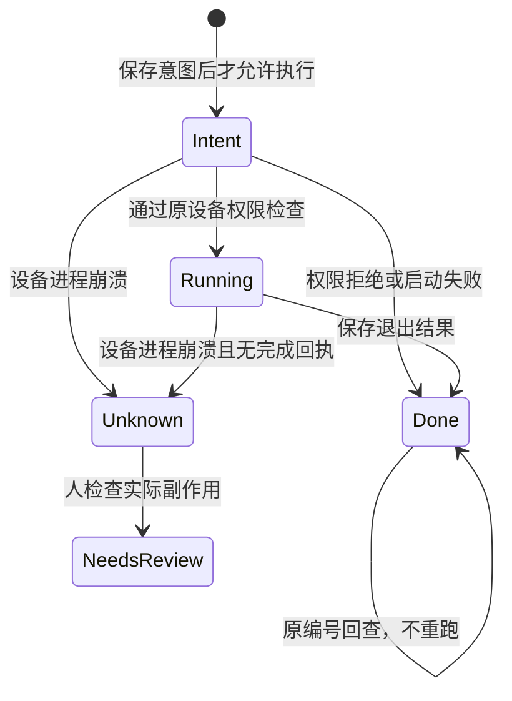

# Operation recovery / 操作恢复

## 中文

Fleet 恢复的是**操作事实和已有工作现场的引用**，不是重放整段对话。
恢复查询绝不执行 `run`，也不自动重建进程、环境变量、数据库事务或插件会话。

### 开启

本地 stdio MCP 配置中可选设置 `FLEET_SESSION_PATH`，值必须是绝对路径，父目录必须已经存在。
例如 `/private/path/fleet-coding-session.json`。每个独立 Agent 使用不同路径；正常关闭后，同一 Agent 重启可复用自己的路径。
默认仍是每进程隔离、内存状态，不新增会话文件。

新 Agent 宣告 `operation_recovery_v1`。开启会话记录后，Tool 在发送命令前保存稳定的操作编号；也可以在 `run` 中显式提供 UUID 格式的 `request_id`。
同一编号只能搭配原命令。WS 与 RTC 生成相同的、按操作端身份隔离的 `corr`，传输切换不会生成第二次执行。
旧 Agent 不提供持久回执；Tool 不向它自动添加 `request_id`，显式要求此能力时在发送命令前报错。

### 使用

断线、丢响应或 MCP 重启后，调用 `recover_session`：

1. 验证原设备仍属于当前账户，并读取当前版本和能力。
2. 按原操作编号调用 `get_result`，缺失完成结果时向设备回查。
3. 读取原 pane 的当前快照；返回保存的 cwd **元数据**，不执行 `cd`。

不要把 `run` 超时理解成“没有执行”。`wait_ms` 仍只是单次 MCP 等待预算，不会杀进程。

### 数据与安全边界

- 设备在 Agent 配置目录的 `operations/` 写入私有回执：输入摘要、状态、退出码和时间。**不写 Token、原始命令、stdout/stderr 或环境变量**。
- 回执按 Token 代际与操作端身份隔离。重置 Token 的签名、断开连接及认证失败规则不变；旧会话文件不能搭配新 Token 使用。
- 同一设备进程仍在时，回查完整的现存 pane 结果。设备进程重启后，已完成操作可返回退出码，但必须标记 `output_unavailable`，不能把没有输出冒充完整结果。
- 重启前只有意图、没有完成回执的操作返回 `unknown`。它可能执行过，也可能没执行；**绝不自动重跑**。
- 设备回执最多 4096 条，不偷偷过期删除幂等证据。存储损坏、不可写或已满时，拒绝启动新的恢复模式操作；普通旧模式命令不受此限制。清理/归档已核验回执会结束对应编号的防重复保证，必须由用户明确决定。
- 会话文件只写设备、操作编号、请求编号和 cwd 元数据，不写凭据或业务输出。私有文件原子替换；文件锁禁止两个 MCP 同时使用同一会话文件。硬崩溃留下 `.lock` 时，必须先核实原进程已退出，才能手工移除该精确锁文件。Windows 依赖用户目录 ACL，应把记录放在自己的私有目录。
- Hub 缓存过期或重启后，可用原请求编号和同一操作端身份验证 `corr`，只重建查询路由，仍不下发命令。
- 这不是对任意 shell 的“恰好执行一次”承诺。断电后的文件系统持久性、外部副作用是否提交、杀死的子进程与插件内部恢复均不在这个保证内。

### 验证

`npm test` 覆盖 Tool、Hub、Worker 查询与隔离；`npm run test:agent:sandbox` 在只读、无特权 Docker 容器中运行 Go 回归，包含并发重复投递、丢连接后完成与副作用次数检查。
不会在真实 Fleet 设备上运行这些故障实验。

## English

Fleet recovers operation facts and references to existing execution state, not a conversation replay.
`recover_session` is read-only: it checks the original device, queries the original operation and observes its pane. Saved cwd is metadata, not a restored shell environment. No command, plugin session or external transaction is automatically recreated.

For local stdio MCP, opt in with an absolute `FLEET_SESSION_PATH` under an existing private directory. Use a different path for every independent agent. Without this setting, process-local isolation and in-memory state remain the default. A normal restart may reuse the original path. A hard crash may leave a lock; verify the old process is gone before manually removing that exact `.lock` file.

Recovery-capable devices advertise `operation_recovery_v1`. In checkpoint mode the Tool saves a stable operation handle before dispatch. An explicit UUID `run.request_id` also opts in. The same identifier and operator produce the same correlation over WS and RTC. The device persists intent before execution and never executes an existing receipt again; different input is rejected. Legacy devices keep the old run contract and reject explicit recovery requirements before dispatch.

Device receipts contain hashes, state, exit code and timestamps, not tokens, raw commands, output or environment variables. They are isolated by credential generation and operator. Token-reset revocation and local execution policy are unchanged. Hub cache expiry can rebuild a query route from the original request ID without sending a run.

While the device process survives, results are queried from its actual pane. After device restart a completed receipt can report its exit code with `output_unavailable`; an unfinished intent is `unknown` and requires inspection, never an automatic retry. The bounded store refuses new recovery-mode work at 4096 receipts rather than silently deleting deduplication evidence. User-approved receipt removal ends the corresponding deduplication guarantee.

This does not promise exactly-once arbitrary shell side effects or power-loss durability. It does not restore dead processes, environment variables, plugin internals or external database transactions. Tests use disposable containers for real child processes, never production devices.
