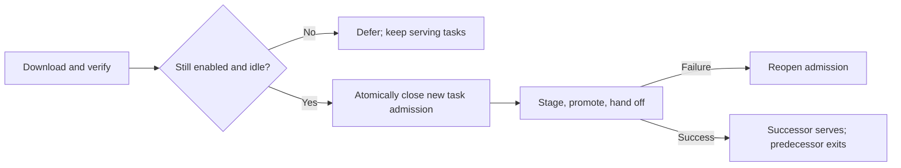

# Automatic-update task protection

Automatic update must not interrupt admitted work. The Agent tracks work from
dispatch through asynchronous execution and result delivery, including the
durable command receipt. Consent approval transfers that reservation without an
idle gap. The same dispatch is used by WebSocket and RTC.

Downloads do not block commands. After checksum verification, the Agent checks
the auto-update toggle, enabled/revoked state, pending approvals, command
admissions, active work, panes, peer sessions and outstanding peer cleanup.
Under the same mutex, an idle Agent closes admission before staging/promotion.

During commit, new business requests receive their existing protocol's failure
response. Duplicate recoverable commands still return the original receipt or
input conflict; unreadable receipts remain unknown. No request is replayed.
Result queries and heartbeat handling are unchanged. An unresolved peer cleanup
record conservatively postpones automatic update rather than killing a plugin.

Explicit local manual update/restart behavior is unchanged; it is not the
automatic idle-update path. This change does not reset tokens, migrate their
format, change permissions, or alter revocation priority.

## Validation (2026-10-13)

Two disposable Debian 12 arm64 Lima VMs, no host mounts, no production
credentials, firewall-limited to loopback, the peer VM and SSH management.
The race compiler was provisioned with offline Debian packages; test guests
remained blocked from Internet access. No production device was restarted.

- Old `main` (`0af151c`) plus `TestAutoUpdatePluginIsNotIdle` fails: a running
  plugin is incorrectly classified as idle. The candidate passes.
- VM A: full `go test -v ./...` with `FLEET_OPERATION_LAB=1`: 304 passed,
  2 skipped (Git and Herdr not installed).
- VM B: 50 repeated focused guard runs, then 20 race-detector rounds on the
  final guard/admission tests. The wider upgrade, receipt and plugin race suite
  also passes.
- Three additional real-process rounds test a command and a local plugin
  arriving during a paused download. All six complete once before PID handoff;
  a repeated command after upgrade returns its durable receipt, not execution.
- Windows amd64 and macOS arm64 test binaries compile. This is not native
  runtime or installer validation for either platform.

Real-process version labels `0.3.0` and `0.3.2` distinguish two builds of the
candidate source. They are **not** historical release binaries. The loopback
Hub fixture is not a production authentication test; existing token, challenge,
revocation and replay regressions are included in the full suite. Plugin
execution uses a local deterministic fixture, not an official plugin download.

Evidence is retained in the private VM lab under `/var/lib/fleet-lab/`:
`update-guard-baseline.log`, `update-guard-full-final.log`,
`update-guard-real-repeat.log`, `update-guard-race-final.log`, and
`update-guard-race-integration.log`.

## First rollout

The fix protects upgrades initiated by an Agent containing this code. It cannot
retroactively fix an older Agent's updater. The first upgrade from released
`v0.6.6` must therefore be scheduled while that device is idle; publishing a
package is not proof that existing machines have safely upgraded. Keep the
production automatic-update announcement separate from package preparation.
