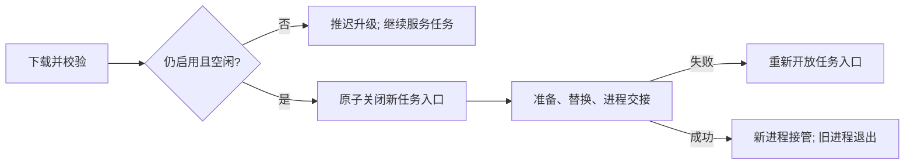

# 自动升级的任务保护

自动升级不能中断已经接收的工作。Agent 从请求分发开始记录忙碌状态，直到
异步执行和结果回传结束，包括命令持久化回执。用户批准待确认任务时，忙碌
状态连续转移，不留下空闲窗口。WebSocket 和 RTC 复用同一个分发入口。

下载安装包时仍可接收命令。校验完成后，Agent 再检查自动升级开关、启用和
撤销状态、待批准请求、命令接收占位、运行中的工作、终端、插件会话及未完成
的插件清理。在同一把锁内，确认空闲后关闭新任务入口，再开始准备和替换程序。

最终替换阶段，新业务请求通过原协议的失败响应明确拒绝。重复的可恢复命令
仍返回原始回执或输入冲突；无法读取回执时仍返回未知，绝不重新执行。
结果查询和心跳逻辑不变。插件清理尚未确认完成时，宁可推迟自动升级，也不
强行终止插件。

本机显式手动升级、重启的行为不变，不属于自动空闲升级路径。本次不重置
Token、不迁移 Token 格式、不改变权限或撤销认证的优先级。

## 验证结果（2026-10-13）

使用两台可丢弃的 Debian 12 arm64 Lima 虚拟机，无宿主机挂载、无生产凭据，
防火墙仅允许本机回环、另一台实验 VM 和 SSH 管理。race 编译器通过离线
Debian 包安装，测试 VM 始终禁止访问外网。没有重启任何生产设备。

- 旧 `main`（`0af151c`）运行 `TestAutoUpdatePluginIsNotIdle` 失败：运行中的
  插件被错误识别为空闲。同一测试在修复版通过。
- VM A 开启 `FLEET_OPERATION_LAB=1` 执行完整 `go test -v ./...`：304 项通过，
  2 项跳过（未安装 Git 和 Herdr）。
- VM B 连续运行 50 轮针对性回归；最终升级锁和请求接收测试再运行 20 轮
  race 检测。升级、回执和插件相关的更大范围 race 测试集也通过。
- 额外重复 3 轮真实进程测试，每轮分别在下载暂停期间下发命令和本地插件。
  六次任务均只执行一次，完成后才发生 PID 交接；升级后重复提交命令返回
  原持久化回执，不重新执行。
- Windows amd64、macOS arm64 测试二进制编译通过；不等同于这两个平台的
  原生运行或安装包验证。

真实进程测试中的 `0.3.0`、`0.3.2` 只是区分同一修复源码的两个构建，
**不是历史 Release 二进制**。回环 Hub 测试夹具不代表生产鉴权测试；完整
测试集另外覆盖现有 Token、challenge、撤销及防重放回归。插件使用本地确定性
夹具，不代表官方插件下载链路。

证据保留在私有 VM 的 `/var/lib/fleet-lab/`：
`update-guard-baseline.log`、`update-guard-full-final.log`、
`update-guard-real-repeat.log`、`update-guard-race-final.log`、
`update-guard-race-integration.log`。

## 首次发布边界

修复只保护包含这段代码的 Agent 发起的后续升级，不能反过来修复旧 Agent
自身的升级器。因此，已发布 `v0.6.6` 的首次升级必须安排在设备空闲时。
准备好安装包不代表所有机器已经安全升级；生产自动升级公告应与安装包准备
分开处理。
