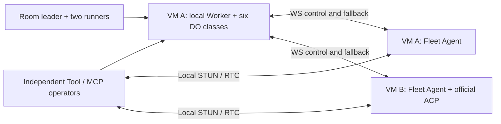

# Two real Linux VMs: isolation and stability lab

This is a **local-only** companion to the container peer-transfer lab. It uses
two Debian 12 arm64 VZ guests, not two containers sharing the host kernel.
Never point these scripts at production, reuse a real token, or mount a home
directory. Guest scripts require `lima-linux-a` / `lima-linux-b`; test execution
uses the unprivileged `fleet-test` user. Provisioning alone uses root.



## Isolation contract

- Use a fresh `mktemp -d /private/tmp/flab-XXXXXX`, mode `0700`, and set its
  `lima/` child as `LIMA_HOME`. Do not reuse the normal Lima or Colima home.
- Define the `fleet-lab` user-v2 network as `192.168.117.0/24` in that private
  Lima home. Use `linux-vm.yaml` for both guests. No mounts or SSH forwarding.
- Confirm guest addresses before provisioning. This fixture expects A at
  `192.168.117.1`, B at `192.168.117.3`, and the gateway at `192.168.117.2`.
  Stop if discovery differs; do not silently operate on another machine.
- Each VM has 2 CPUs, 3 GiB RAM and a 12 GiB disk. Agent services have 1 GiB
  limits; the local Hub group has 2 GiB. No privileged Docker or host socket.
- Provision dependencies first. Then `linux-setup.mjs isolate` installs guest
  nftables rules allowing only loopback, peer VM traffic and SSH management.
  Verify both guests cannot reach `https://1.1.1.1` before starting tests.
- Credentials live only in guest `0600` files under private state directories.
  Never copy `seed.json`, `room.env`, `.dev.vars`, Agent config, or a VM disk into
  a repository or report. Automatic Agent updates are explicitly disabled.
- HTTP is confined to this disposable, firewall-restricted network. This is not
  a production TLS configuration or a validation of public-network security.

## Recreate the fixture

The helpers are intentionally explicit, not a production installer:

1. Start the two named VMs from `linux-vm.yaml` in the private Lima home.
2. Install checksum-verified Node 22.22.0 arm64 as `/usr/local/bin/node` and npm.
   Copy the required `packages/fleet-{agent,tool,room,worker,hub}` sources and
   `scripts/plugin-peer-vm/` into `/opt/fleet-lab/workspace`. Do not copy `.git`,
   `.env`, host credentials or `node_modules`. On macOS use
   `COPYFILE_DISABLE=1 tar --no-xattrs` to avoid AppleDouble pseudo-test files.
3. Build the Agent with `CGO_ENABLED=0 GOOS=linux GOARCH=arm64 go build` and stage
   it as `/opt/fleet-lab/fleet-agent`. Build `recovery-stun.go` as
   `/opt/fleet-lab/stun` using the Agent module's Go dependencies.
4. Run `linux-setup.mjs hosts` on both guests. On A, run `hub`, then as
   `fleet-test` run `linux-suite.mjs seed`. This is a one-time initialization,
   **not** a retry or token-reset command. Transfer the resulting private seed
   to B with mode `0600` and ownership `fleet-test`.
5. The `hub` helper pins Wrangler 4.125.0, Miniflare 5.20260820.0-alpha,
   esbuild 0.28.1, werift 0.24.4 and ws 8.18.3. Install the same dependencies
   under `/opt/fleet-lab/runtime` on B and link each workspace's `node_modules`.
   `linux-hub.mjs` builds once and runs workerd through Miniflare's public
   compatibility converter. No watcher, inspector, remote bindings or deploy.
   The config and DO database are private to `/var/lib/fleet-hub-lab`.
6. Run `agent a` on A, `agent b` on B; `room leader peer-a` on A,
   `room peer-b` on B; and `stun` on A. Both guests use the same private Hub
   token, but every Tool/operator has independent recovery state and identity.
7. Download the exact official ACP artifact named by the generated catalog,
   put it at guest `/tmp/fleet-acp-plugin`, and run `linux-setup.mjs plugin`.
   This verifies the catalog SHA-256 and writes normal installed-plugin metadata.
   **This tests plugin runtime, not the download/install transport.**
8. Run `isolate 192.168.117.1 192.168.117.3` on both guests; check egress denial.

The Room ACP fixture performs real Fleet commands through scoped Room tools.
The official ACP plugin runs `linux-plugin-acp.mjs` as its downstream ACP agent.
Both are deterministic protocol fixtures, **not a claim of testing an LLM**.

## Run and inspect

Set `LIMA_HOME` to the private lab before each `limactl` invocation. Each run ID
must be new; existing evidence is not overwritten. Run tests as `fleet-test`:

```bash
limactl shell linux-a -- sudo -u fleet-test node /opt/fleet-lab/workspace/scripts/plugin-peer-vm/linux-suite.mjs auth auth-1
limactl shell linux-a -- sudo -u fleet-test node /opt/fleet-lab/workspace/scripts/plugin-peer-vm/linux-suite.mjs test round-1
limactl shell linux-a -- sudo -u fleet-test node /opt/fleet-lab/workspace/scripts/plugin-peer-vm/linux-suite.mjs sessions terminals-1
limactl shell linux-a -- sudo -u fleet-test node /opt/fleet-lab/workspace/scripts/plugin-peer-vm/linux-suite.mjs remote remote-1
limactl shell linux-a -- sudo -u fleet-test node /opt/fleet-lab/workspace/scripts/plugin-peer-vm/linux-suite.mjs plugins plugins-1
limactl shell linux-a -- sudo -u fleet-test node /opt/fleet-lab/workspace/scripts/plugin-peer-vm/linux-suite.mjs soak soak-1
limactl shell linux-a -- sudo -u fleet-test node /opt/fleet-lab/workspace/scripts/plugin-peer-vm/linux-suite.mjs retention retention-1
```

Use the host-side `linux-fault-host.mjs LAB_DIRECTORY RUN_ID` for the six fault
cases. It only accepts the two named VMs and restores its dedicated fault
firewall table in `finally`. Run fault tests **before**, not during, the steady
soak. Do not mask transport errors by automatically replaying mutating requests.

Copy `linux-health.mjs` to `/tmp/linux-health.mjs` on both VMs. On the host run
`linux-observe-host.mjs LAB_DIRECTORY HEALTH_RUN_ID` alongside the soak. It
records 61 samples at 30-second intervals: connection state, process identity,
restart counters, cgroup memory/OOM and open descriptors. Compare restart
**deltas**; an earlier intentional crash may leave a nonzero baseline.

For retention validation, use a fresh disposable Agent state namespace, never
delete existing operation receipts to make room. `linux-retention-prepare.mjs`
copies lab configuration/plugins but excludes operation history, preserves the
old directory and receipt count, and points the lab service at the new state.
It refuses to overwrite an existing namespace. Reapply and verify isolation
after a VM reboot; the lab's runtime nftables rules are not a persistent firewall.

`retention` keeps a 15-minute task running on each guest while four load waves
complete 512 short tasks per machine per wave. It observes for 20 minutes without
Agent restarts or forced GC, then clears only the disposable Hub cache to verify
evicted output still has its original exit code and cannot be replayed. Health
includes cgroup anonymous memory and Agent process RSS, not only file cache.
Pass `41` as the observer's optional third argument for a 20-minute window.

Evidence is guest `/var/lib/fleet-lab/RUN_ID/evidence.ndjson`; health and fault
controller evidence are in the private host lab directory. Failed runs remain
failed and must not be counted as successful soak time.

For full Go regression, stage Linux `agent.test`, `pane.test`, `backend.test`,
and `policy.test` under `/opt/fleet-lab/`, plus Go 1.25 and vendored test fixture
dependencies. Run `linux-go-tests.mjs`. `linux-node-tests.mjs` covers Tool/Room
Node suites and authentication. Worker TypeScript suites can be bundled with
esbuild (`--platform=node --format=esm --packages=external`) and run beside the
original test/source/config fixtures inside the guest.

Stop only `linux-a` and `linux-b` after exporting redacted evidence. Stopping
retains their disks for investigation; do not delete a whole Lima home.

## Limits

- A passed 30-minute window is not an uptime guarantee.
- Plugin completion retries are memory-only, last at most two minutes, retain
  the original correlation and authorization identity, and never rerun plugins.
  Agent process death or a longer outage can still lose a plugin result.
- Operator fingerprints prevent accidental routing collisions. Agents sharing
  an administrator token are not mutually hostile security tenants.
- No real macOS/Windows, desktop display, host suspend/lid-close, public NAT or
  cloud deployment is covered by this Linux headless lab.
