# Self-hosted Hub releases

Production runs on `47.119.33.203` behind its existing named Cloudflare Tunnel.
`Release self-hosted Hub` publishes `hub-<full source commit>` only after the
current main commit passes CI. It packages the Worker, self-hosted adapter and
public assets, then attests the archive. Hub releases use `--latest=false` so
the Agent installer continues to discover `v*` Agent releases.

```mermaid
flowchart LR
  CI[Main CI passes] --> Build[Build and attest Hub archive]
  Build --> Release[Publish immutable hub-SHA release]
  Release --> Pull[Server polls every five minutes]
  Pull --> Verify[Verify workflow and source digest]
  Verify --> Candidate[Start isolated candidate with empty state]
  Candidate --> Backup[Encrypted production backup]
  Backup --> Switch[Switch current symlink and restart Hub]
  Switch --> Check[Check health source and assets]
  Check -->|failure| Rollback[Restore previous code]
```



The server needs Python 3.9+, curl and GitHub CLI at `/opt/fleet/bin/gh`.
Attestations are included in each release, so verification needs no GitHub
credential. The server's TLS certificate verification stays enabled. The
published package never includes `hub.capnp`, credentials, workerd or state.
The existing workerd SHA-256 is checked before activation. Existing durable
object namespace keys, `/var/lib/fleet/state`, OAuth relay settings and Tunnel
configuration stay on the host. No automatic database rollback is attempted.

Install `deploy.py` at `/opt/fleet/deploy.py`, then install the service/timer from
this directory. Run the service successfully once before enabling the timer:

```sh
systemctl daemon-reload
systemctl start fleet-deploy.service
systemctl enable --now fleet-deploy.timer
```

Read `/opt/fleet/deployment.json`, `/opt/fleet/deployment-error.json` and
`journalctl -u fleet-deploy.service`. A failed deployment remains visible in
systemd; the timer does not mean production has updated. The previous release
is retained at `/opt/fleet/previous`; `/opt/fleet/assets.before-releases` is the
original asset directory. Release directories are deliberately retained for
operator-controlled cleanup. No automatic Agent update is enabled by this Hub
pipeline; Agent binaries are published separately by `release-agent.yml`.

The initial deployment must verify public health/source, Google authorization
start, authenticated challenge, WSS/MCP and real device command execution. A
health endpoint alone is not evidence that those paths work. A Hub restart
briefly disconnects devices; they must reconnect. Changes that require new
namespace bindings or a different workerd version need an explicit migration.

Keep the old `Deploy hosted hub` Cloudflare workflow disabled for this host.
